<div align="center">

<h1>🗺️ Canvas WebGIS Engine & Guangzhou Navigation</h1>

<p><strong>轻量级 TypeScript / Canvas 2D 矢量地图引擎，以及基于该引擎构建的广州离线导航应用</strong></p>

<p>
  <code>GeoJSON</code> ·
  <code>MVT / Protobuf</code> ·
  <code>Packed R-tree</code> ·
  <code>Tile Scheduler</code> ·
  <code>Route Visualization</code>
</p>

<p>
  
  
  
  
  
  
</p>

<p>
  <a href="#项目定位">项目定位</a> ·
  <a href="#workspace-架构">Workspace 架构</a> ·
  <a href="#核心能力">核心能力</a> ·
  <a href="#性能证据">性能证据</a> ·
  <a href="#快速开始">快速开始</a> ·
  <a href="#项目文档">项目文档</a>
</p>

</div>

---

## 项目定位

`nav-map-sys-front` 由两个边界清晰的 workspace 组成：

- `@zhaolong/canvas-webgis`：不依赖前端框架的矢量地图渲染库；
- `@zhaolong/navigation`：使用该渲染库实现的广州离线导航应用。

渲染库不依赖第三方地图渲染 SDK，直接完成 MVT 调度、Protobuf 解码、空间索引、图层绘制、
标注碰撞、几何拾取和地图交互。导航应用只通过包的公共 API 使用引擎，不引用其内部源码，
既是实际业务应用，也是渲染库的集成验证场景。

### 项目速览

| 渲染内核 | 数据能力 | 工程质量 | 业务落地 |
| --- | --- | --- | --- |
| TypeScript + Canvas 2D | GeoJSON / MVT Adapter | 17 项自动化测试 | 广州离线矢量底图 |
| 仿射坐标变换与拾取 | Packed R-tree | TypeDoc API Reference | POI 搜索与空间查询 |
| 专题符号与标注碰撞 | 瓦片去重、缓存与回退 | 可复现浏览器 Benchmark | 路径规划与游览路线 |

## Workspace 架构

```text
nav-map-sys-front/
├─ packages/
│  └─ webgis/                  # 可独立构建和发布的 Canvas WebGIS 库
│     ├─ src/                  # Geometry、Layer、Renderer、Source、Adapter
│     ├─ tests/                # 正确性与回归测试
│     ├─ benchmarks/           # 空间查询与浏览器绘制性能测试
│     └─ docs/                 # 使用文档与 TypeDoc API
├─ apps/
│  └─ navigation/              # 广州离线导航应用
│     ├─ src/
│     └─ public/
├─ package.json                # npm workspace 与统一脚本入口
└─ package-lock.json
```



```mermaid
flowchart LR
    API["Spring Boot / PostGIS API"] -->|JSON / MVT| APP["Navigation App"]
    APP -->|Public API| ENGINE["@zhaolong/canvas-webgis"]
    ENGINE --> SOURCE["GeoJSON / VectorTile Source"]
    SOURCE --> ADAPTER["GeoJSON / MVT Adapter"]
    ADAPTER --> MODEL["Feature / Geometry"]
    MODEL --> INDEX["Packed R-tree"]
    INDEX --> RENDER["Canvas 2D Renderer"]
    RENDER --> UI["Map Interaction & Visualization"]
```

### 包之间的边界

| 模块 | 负责 | 不负责 |
| --- | --- | --- |
| Loader / Source | 网络请求、瓦片调度、去重、LRU 缓存、取消和父级回退 | 业务 UI 与符号面板 |
| Adapter | 将 GeoJSON 或 MVT 转换成统一 Feature / Geometry 模型 | 发起网络请求 |
| Renderer / Layer | 视口筛选、符号表达、Canvas 绘制、标注和拾取 | 后端空间计算 |
| Navigation App | 搜索、路线交互、图层控制和结果展示 | 修改渲染库内部实现 |

## 核心能力

### 广州导航应用

- 广州市域 OSM 组合矢量底图，支持道路、行政区、水面、土地覆盖、建筑与停车区域；
- POI 关键字、附近和视口查询，支持屏幕空间聚类与要素详情；
- 地图点选或 POI 搜索设置起点、终点和游览点；
- 步行/驾车、最快/最短两点路径规划；
- 2～12 个地点的访问顺序优化和分段路线展示；
- 蓝色导航路线、白色外描边、圆角连接以及绿色起点/红色终点；
- 独立控制底图、POI、路线、路径点和吸附结果图层。

### Canvas WebGIS 渲染库

| 模块 | 说明 |
| --- | --- |
| 数据与图层 | GeoJSON 与 MVT 数据源、同步要素图层、异步矢量瓦片图层 |
| 空间索引 | Packed R-tree 加速视口要素筛选，支持要素变更后的延迟重建 |
| 地图交互 | 仿射矩阵正反变换、鼠标锚点缩放、平移、点击拾取和视口事件 |
| 瓦片调度 | 局部瓦片金字塔、请求去重、LRU 缓存、父级回退和离屏请求取消 |
| Canvas 渲染 | 点/线/面、多几何、专题符号、标注碰撞、圆角路线与屏幕空间命中测试 |

## 性能证据

`tests` 验证结果是否正确，`benchmarks` 衡量相同结果下的执行耗时。下面的数据属于
固定环境下的微基准，用于验证优化效果，不代表生产环境容量。

| 场景 | 对照方案 | 优化方案 | 结果 |
| --- | ---: | ---: | ---: |
| 10 万点、每轮 100 次固定视口查询 | 线性扫描约 200 ms | Packed R-tree 约 0.88 ms | 批次总耗时 P50 显著下降 |
| Chrome Canvas 2D，连续绘制 600 帧 | 平均约 1.35 ms/帧 | 平均约 0.15 ms/帧 | 平均绘制耗时下降约 88.9% |
| 同一浏览器绘制基准 | P95 约 1.9 ms | P95 约 0.3 ms | 慢帧波动明显收敛 |

测试环境、统计单位与适用边界见
[前端测试与性能证据](packages/webgis/docs/frontend-testing-evidence.md)。

```powershell
npm run test:run
npm run bench:spatial
npm run bench:render
```

## 数据链路

```text
Spring Boot / PostGIS
  → GET /api/v1/map/tiles/base/{z}/{x}/{y}.mvt
  → VectorTileSource（调度、去重、缓存、取消）
  → @mapbox/vector-tile + pbf
  → Feature / Geometry / Renderer
  → CanvasMapRenderer
```

业务地图范围由 `GET /api/v1/map/tiles/bounds` 动态读取，页面不再依赖早期的小谷围岛
静态 GeoJSON 作为主底图。`apps/navigation/public/map` 中的文件仅保留作兼容示例。

## 快速开始

### 环境要求

- Node.js 20 或更高版本；
- npm 10 或更高版本；
- 使用完整导航功能前，先启动相邻的 `nav-map-sys` 后端。

### 安装与启动

先启动 `nav-map-sys` 后端，再执行：

```powershell
npm install
npm run test:run
npm run dev
```

开发地址为 `http://localhost:5173`，Vite 会把 `/api` 代理到
`http://localhost:8080`。当前自动化套件包含 5 个测试文件、17 项测试。

### 生产构建

```powershell
npm run build
```

构建命令会分别生成 `packages/webgis/dist`（ESM 与 TypeScript 声明文件）和
`apps/navigation/dist`（导航应用），不会隐式修改相邻后端仓库。需要由 Spring Boot
托管时，再显式复制导航应用产物。

### 常用命令

| 命令 | 用途 |
| --- | --- |
| `npm run dev` | 启动导航应用开发服务器 |
| `npm run build` | 构建渲染库和导航应用 |
| `npm run build:webgis` | 只构建可发布的 WebGIS 包 |
| `npm run build:navigation` | 只构建导航应用 |
| `npm run test:run` | 执行渲染库测试 |
| `npm run bench:spatial` | 对比线性扫描与 Packed R-tree |
| `npm run bench:render` | 在 Chrome 中执行 Canvas 绘制基准 |
| `npm run docs:check` | 严格检查 TypeDoc 注释和引用 |
| `npm run docs` | 生成 HTML API Reference |

## 已接入接口

<details>
<summary>展开接口列表</summary>

| 领域 | 接口 |
| --- | --- |
| POI | `GET /api/v1/pois` |
| POI | `GET /api/v1/pois/nearby` |
| POI | `GET /api/v1/pois/viewport` |
| POI | `GET /api/v1/pois/{id}` |
| 路由 | `POST /api/v1/routing/snap` |
| 路由 | `POST /api/v1/routing/routes` |
| 路由 | `POST /api/v1/routing/tours` |
| 地图 | `GET /api/v1/map/tiles/bounds` |
| 地图 | `GET /api/v1/map/tiles/base/{z}/{x}/{y}.mvt` |

</details>

路线几何由后端以 Web Mercator WKT 返回，浏览器将其转换为 GeoJSON 后交给 Canvas
内核渲染。页面坐标、MVT 和路由几何保持在同一个 `EPSG:3857` 空间。

## 项目文档

| 文档 | 内容 |
| --- | --- |
| [文档索引](packages/webgis/docs/README.md) | 推荐阅读顺序与文档导航 |
| [上手与使用案例](packages/webgis/docs/getting-started-and-examples.md) | 安装、初始化和常见场景 |
| [公共 API Reference](packages/webgis/docs/api-reference.md) | 公共模块与 API 设计 |
| [架构与模块](packages/webgis/docs/architecture.md) | 内核分层、依赖方向和扩展方式 |
| [前端测试与性能证据](packages/webgis/docs/frontend-testing-evidence.md) | 测试环境、样本和统计口径 |
| [原始架构演进记录](packages/webgis/ARCHITECTURE.md) | 设计背景与演进决策 |

执行 `npm run docs` 生成完整 TypeDoc，然后打开
`packages/webgis/docs/api/index.html`。

---

<div align="center">
  <sub>Framework-agnostic rendering core · Reproducible benchmarks · Real navigation integration</sub>
</div>
