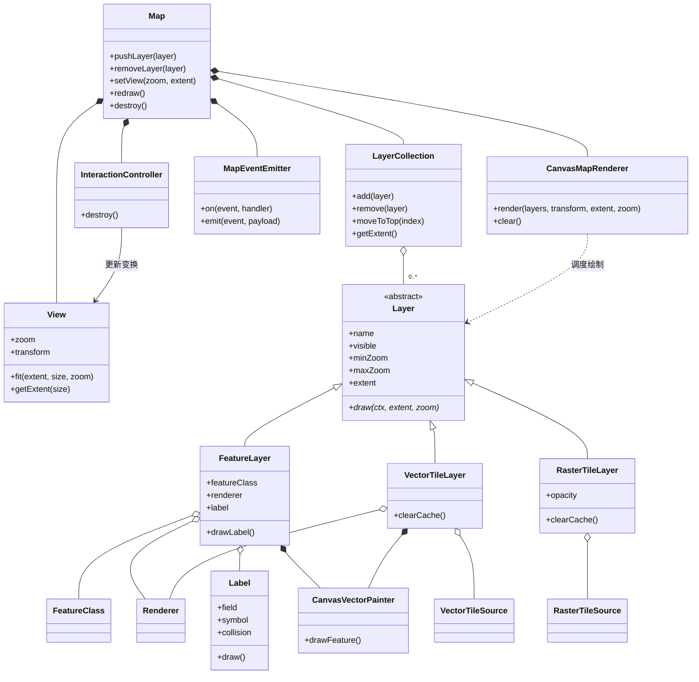
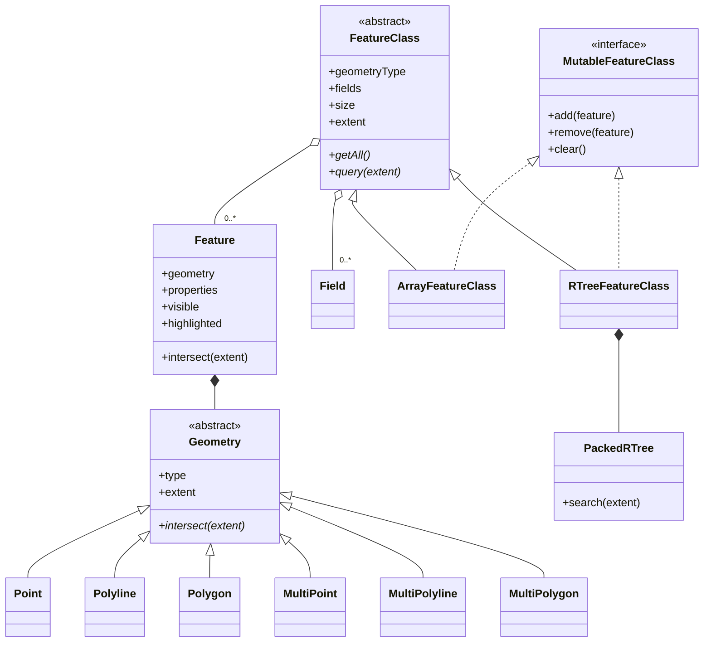
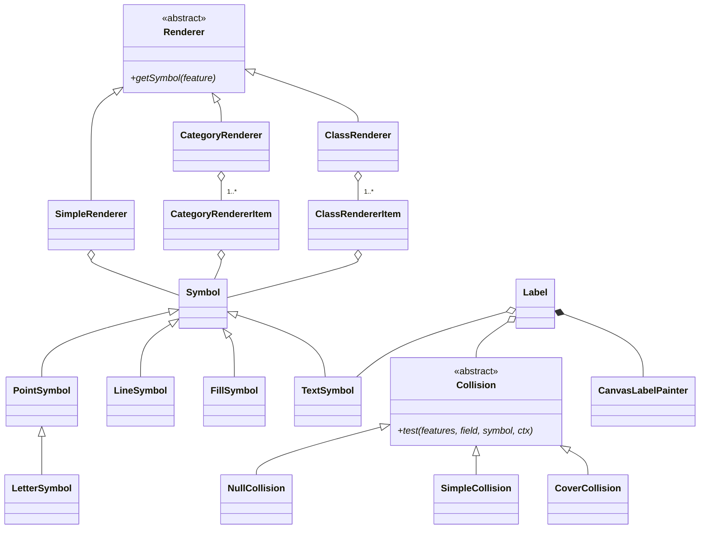
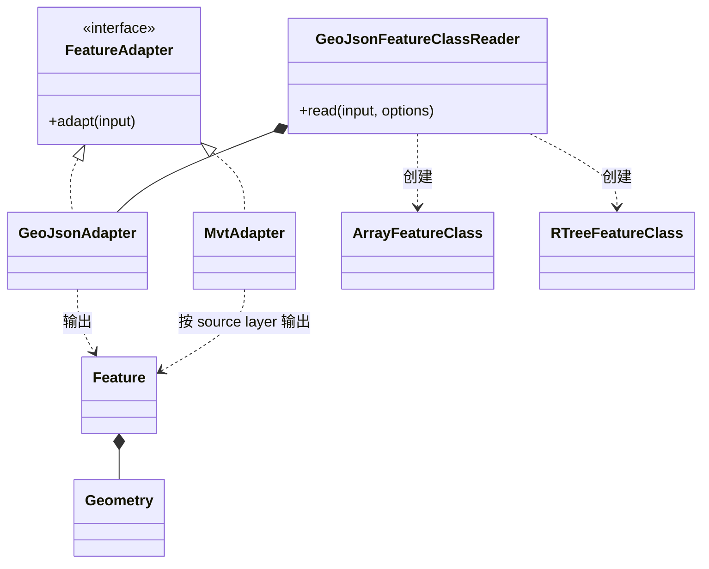
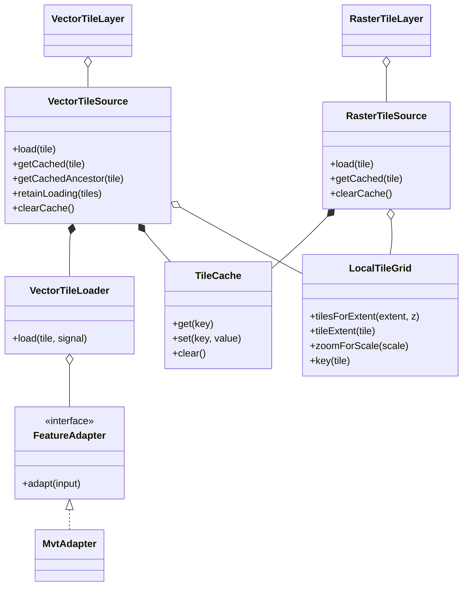
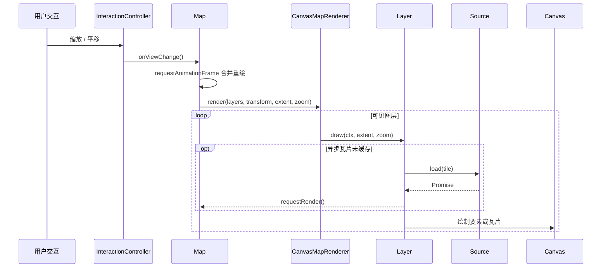

# uml-class-diagram

本文展示 <code>@zhaolong/canvas-webgis</code> 的主要类关系。图中只保留理解架构所需的
公开类和关键依赖，构造参数、全部属性与方法签名请查看
[TypeDoc API](api-reference.md)。

关系说明：

- <code>&lt;|--</code>：继承；
- <code>&lt;|..</code>：实现接口；
- <code>*--</code>：组合，由拥有者管理生命周期；
- <code>o--</code>：聚合，可由外部创建并注入；
- <code>--&gt;</code> / <code>..&gt;</code>：调用或依赖。

## 1. 地图门面、图层与 Canvas 渲染

<code>Map</code> 是对外门面，负责协调视图、图层集合、Canvas 合成器、事件和交互。
具体图层只实现自己的绘制策略；地图在同一动画帧内合并多次重绘请求。

## 2. Geometry、Feature、Renderer 与 Label

<code>FeatureClass</code> 只规定查询契约。<code>ArrayFeatureClass</code> 使用线性扫描，
<code>RTreeFeatureClass</code> 使用 Packed R-tree；写操作后索引会在下一次查询时延迟重建。
Renderer 负责选择 Symbol，Canvas Painter 负责真正绘制，两者相互解耦。

## 3. Adapter、Loader、Source 与瓦片调度

瓦片链路有意拆成四层：

1. <code>LocalTileGrid</code> 只负责坐标、层级和瓦片范围计算；
2. <code>Loader</code> 负责 HTTP 获取，<code>Adapter</code> 负责格式转换；
3. <code>Source</code> 负责请求去重、LRU、失败退避、取消与父级回退；
4. <code>Layer</code> 根据当前视口向 Source 请求数据并完成绘制。

这种拆分使网络策略、数据格式与渲染策略可以分别替换，也解释了为什么加入
<code>MvtAdapter</code> 后仍然保留 <code>VectorTileLoader</code>。

## 一帧绘制的调用顺序

